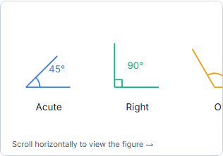
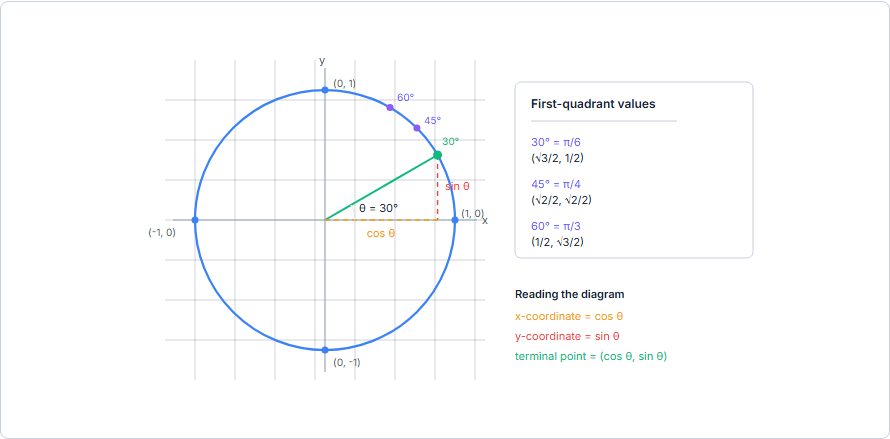
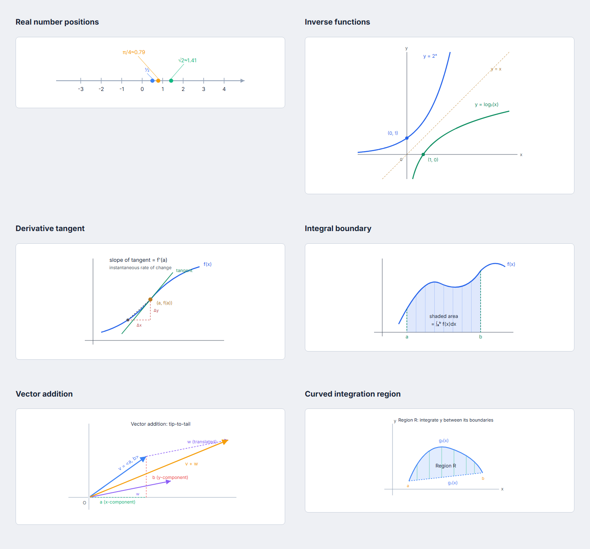
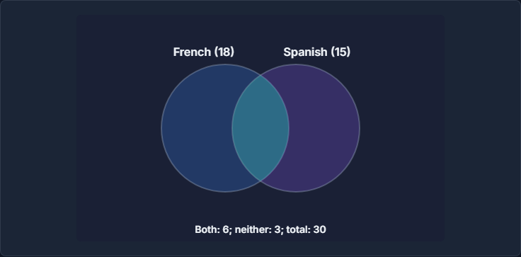

# Repaired lesson figures

These screenshots show original diagrams rendered by the app. They contain
no textbook pages or external reference material.

## Geometry on a narrow screen

Angle labels stay inside the diagram. Wide figures retain readable dimensions
and can be scrolled with a keyboard or touch.

## Trigonometry

The unit circle places the common-angle markers on the circle and keeps their
labels readable. Graphs use the stated angle units and separate tangent branches.

## Algebra and calculus

This gallery collects six rendered lesson figures: number positions, inverse
functions, a derivative tangent, an integral boundary, vector addition, and a
curved integration region. Points, line slopes, translated vectors, and shaded
boundaries follow the same mathematical models as their curves.

## GRE set relationships

The Venn diagram states the counts and total. Its shape illustrates membership;
the areas are schematic.

